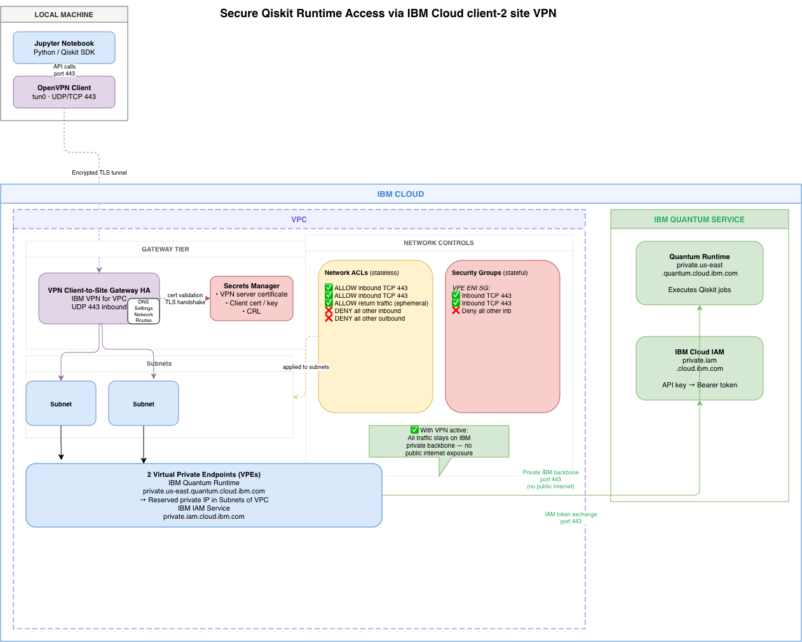

# IBM Cloud VPC — Qiskit Secure Access

Terraform automation that provisions a production-ready IBM Cloud environment for private, secure access to IBM Quantum Platform (Qiskit Runtime).

## Architecture



## What gets created

| Resource | Details |
|---|---|
| **VPC** | Single VPC with 3 availability zones and 3 subnets |
| **Secrets Manager** | Reuse an existing instance by name, or create a new `standard` plan instance |
| **PKI Certificates** | CA, VPN server cert, and client cert generated locally via EasyRSA and imported into Secrets Manager |
| **Client-to-Site VPN** | `ibm_is_vpn_server` with certificate authentication, 600 s idle timeout, split tunnelling, IBM Cloud DNS pushed to clients |
| **Qiskit Runtime** | `quantum-computing` service, `paygo-standard` plan, QPU cost limit of 600 seconds (≈ $1,000 USD) |
| **VPE — IBM Quantum** | Private endpoint gateway for `private.<region>.quantum.cloud.ibm.com` bound across all 3 subnets |
| **VPE — IAM** | Private endpoint gateway for IBM Cloud IAM bound across all 3 subnets |

---

## Prerequisites

| Tool | Purpose |
|---|---|
| [Terraform](https://developer.hashicorp.com/terraform/install) ≥ 1.5 | Infrastructure provisioning |
| [IBM Cloud Terraform Provider](https://registry.terraform.io/providers/IBM-Cloud/ibm/latest) ≥ 2.8.1 | Automatically installed by `terraform init` |
| [IBM Cloud CLI](https://cloud.ibm.com/docs/cli) | Optional — useful for validating resources post-apply |
| `git` | Required on the Terraform operator machine — EasyRSA is cloned at apply time |
| `bash` + `openssl` | Required on the Terraform operator machine — used by EasyRSA internally |
| IBM Cloud API key | Must have permissions to create VPC, Secrets Manager, and resource instances |

---

## Quick start

### 1 — Clone and enter the Terraform directory

```bash
git clone <this-repo>
cd qiskit-secure-access/terraform
```

### 2 — Create your variable file

```bash
cp terraform.tfvars.example terraform.tfvars
```

Edit `terraform.tfvars` and set at minimum:

```hcl
ibmcloud_api_key = "YOUR_IBM_CLOUD_API_KEY"
region           = "us-east"   # or "eu-de"
prefix           = "qsk"
```

### 3 — Initialise Terraform

```bash
terraform init
```

### 4 — Review the plan

```bash
terraform plan
```

### 5 — Apply

```bash
terraform apply
```

On first apply Terraform will:
1. Clone the [EasyRSA](https://github.com/OpenVPN/easy-rsa) repository into `pki-work/`
2. Generate a CA, VPN server certificate, and VPN client certificate
3. Copy the generated PEM files into `pki-output/`
4. Import the certificates into Secrets Manager
5. Provision all VPC, VPN, Qiskit, and VPE resources

---

## Variables

All variables have sensible defaults. Override any of them in `terraform.tfvars`.

| Variable | Default | Description |
|---|---|---|
| `ibmcloud_api_key` | — | IBM Cloud API key (**required**) |
| `region` | `us-east` | Deployment region (`us-east` or `eu-de`) |
| `resource_group_name` | `default` | Existing resource group name |
| `prefix` | `qsk` | Short prefix prepended to all resource names |
| `vpc_cidr` | `10.0.0.0/16` | Informational VPC address space |
| `zone1_cidr` | `10.0.1.0/24` | Subnet CIDR for zone 1 |
| `zone2_cidr` | `10.0.2.0/24` | Subnet CIDR for zone 2 |
| `zone3_cidr` | `10.0.3.0/24` | Subnet CIDR for zone 3 |
| `vpn_client_ip_pool` | `172.16.0.0/22` | IP pool assigned to VPN clients (must not overlap VPC CIDRs) |
| `vpn_port` | `443` | VPN server port |
| `vpn_protocol` | `udp` | VPN protocol (`udp` or `tcp`) |
| `vpn_dns_server_ips` | `["161.26.0.7","161.26.0.8"]` | IBM Cloud private DNS resolvers pushed to clients |
| `vpn_ibm_dns_cidr` | `161.26.0.0/16` | IBM DNS CIDR routed through the VPN tunnel |
| `existing_secrets_manager_name` | `""` | Name of an existing SM instance — leave empty to create a new one |
| `secrets_manager_plan` | `standard` | Plan for a new SM instance (`standard` or `trial`) |
| `qiskit_instance_name` | `qiskit-paygo` | Name for the Qiskit Runtime service instance |
| `qiskit_limit_seconds` | `600` | QPU cost limit in seconds (600 s ≈ $1,000 USD) |

---

## Reusing an existing Secrets Manager

If you already have a Secrets Manager instance in the same region, set its name in `terraform.tfvars`:

```hcl
existing_secrets_manager_name = "my-existing-sm"
```

Terraform will look it up via a `data` source and use its GUID — no new instance will be created.

---

## Connecting to the VPN

After `terraform apply` completes:

1. **Download the VPN client profile** from the IBM Cloud console:
   - Navigate to **VPC Infrastructure → VPNs → Client-to-site servers**
   - Select `<prefix>-vpn-server` → **Download client profile**

2. **Update the `<ca>` block** in the downloaded `.ovpn` profile with the contents of `pki-output/ca.crt`

3. **Add your client certificate and key** to the profile:
   ```
   pki-output/client.crt  →  <cert> block
   pki-output/client.key  →  <key> block
   ```

4. **Connect** using any OpenVPN-compatible client (e.g. [Tunnelblick](https://tunnelblick.net/) on macOS, [OpenVPN Connect](https://openvpn.net/client/))

Once connected, your machine can reach:
- VPC subnet resources via the zone routes (`10.0.1-3.0/24`)
- IBM Quantum Platform privately via the VPE (`private.<region>.quantum.cloud.ibm.com`)
- IBM IAM privately via the IAM VPE
- IBM Cloud DNS resolvers at `161.26.0.7` / `161.26.0.8`

---

## Using Qiskit Runtime over the private endpoint

```python
from qiskit_ibm_runtime import QiskitRuntimeService

service = QiskitRuntimeService(
    token="YOUR_API_KEY",
    instance="YOUR_INSTANCE_CRN",   # from terraform output qiskit_instance_crn
    channel="ibm_cloud",
    private_endpoint=True,          # routes traffic via the VPE
)
```

> Requires `qiskit-ibm-runtime` ≥ 0.24.0

An end-to-end Jupyter Notebook example demonstrating private endpoint connectivity and running a circuit on Qiskit Runtime is provided at [`example-qiskit-python/qiskit_example.ipynb`](example-qiskit-python/qiskit_example.ipynb).

---

## Key outputs

After `terraform apply`, the following outputs are available via `terraform output`:

| Output | Description |
|---|---|
| `vpc_id` | VPC ID |
| `subnet_ids` | List of 3 subnet IDs |
| `secrets_manager_id` | Secrets Manager instance GUID |
| `server_cert_crn` | CRN of the imported VPN server certificate |
| `client_cert_crn` | CRN of the imported VPN client certificate |
| `vpn_server_hostname` | VPN server hostname for the OpenVPN client profile |
| `qiskit_instance_crn` | Qiskit Runtime instance CRN |
| `qiskit_vpe_id` | IBM Quantum VPE gateway ID |
| `iam_vpe_id` | IAM VPE gateway ID |
| `pki_output_path` | Local path to generated cert/key files |

---

## Destroy

```bash
terraform destroy
```

> The `pki-work/` and `pki-output/` directories are **not** removed by Terraform destroy. Delete them manually if you want to clean up the local PKI:
> ```bash
> rm -rf terraform/pki-work terraform/pki-output
> ```

---

## Project layout

```
.
├── README.md
├── bob-plan/
│   └── ibm-vpc-qiskit-vpn-plan.md   # Architecture and implementation plan
├── example-qiskit-python/
│   └── qiskit_example.ipynb          # Example Jupyter Notebook using private VPE
└── terraform/
    ├── main.tf                       # Provider configuration
    ├── variables.tf                  # All input variables
    ├── outputs.tf                    # All outputs
    ├── vpc.tf                        # VPC and subnets
    ├── secrets_manager.tf            # Conditional SM lookup/create + IAM auth
    ├── pki.tf                        # EasyRSA local-exec + certificate import
    ├── vpn.tf                        # Client-to-site VPN server + routes
    ├── qiskit.tf                     # Qiskit Runtime service instance
    ├── vpe.tf                        # VPEs for IBM Quantum and IAM
    └── terraform.tfvars.example      # Variable template — copy to terraform.tfvars
```
